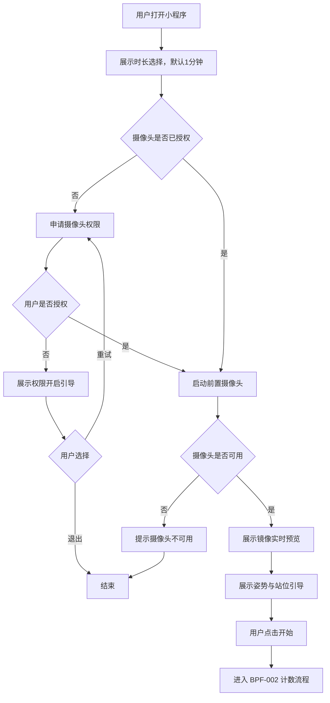
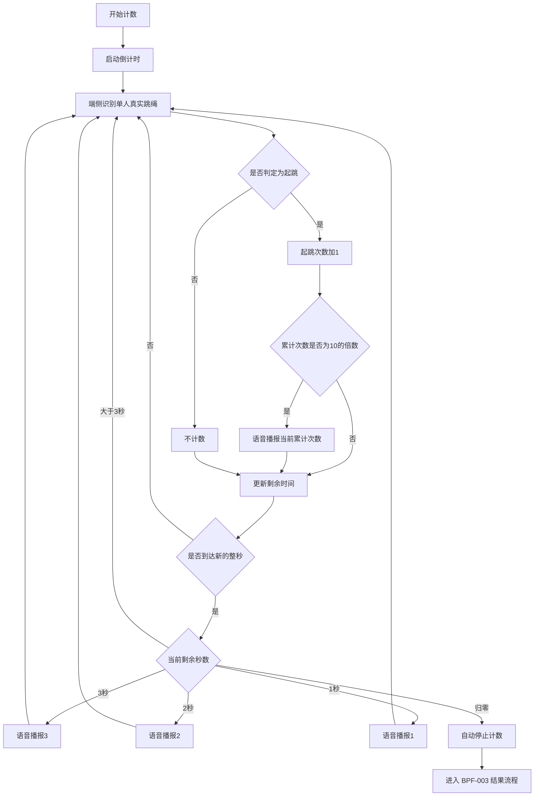
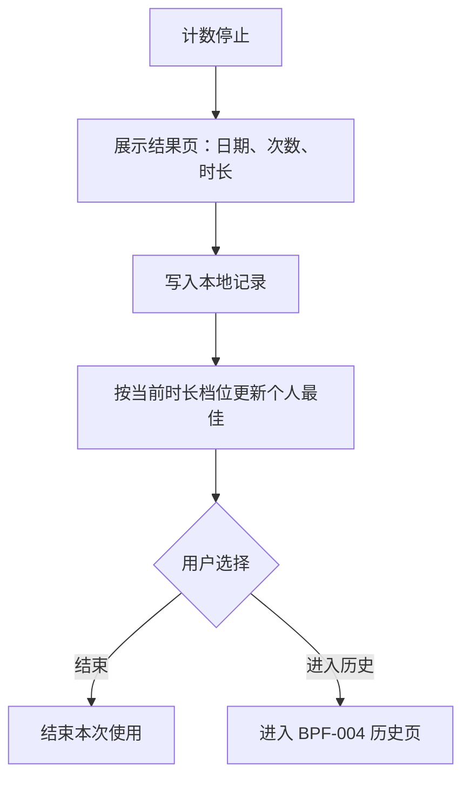
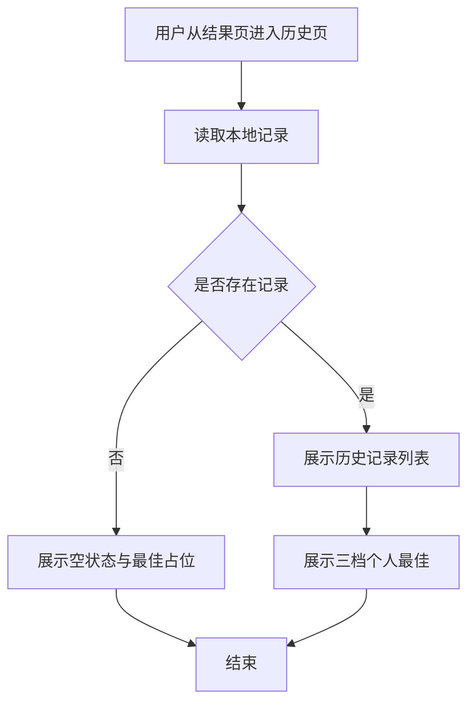
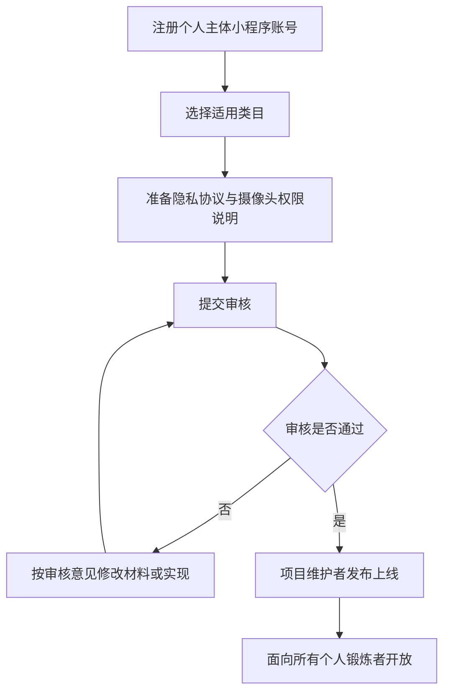
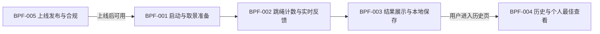

# 业务流程

## 元信息

| 属性 | 值 |
|------|-----|
| 项目编码 | PRJ-001 |
| 项目名称 | 微信跳绳计数器 |
| 文档版本 | v1.2 |
| 创建日期 | 2026-10-30 |
| 最后更新 | 2026-10-30 |

---

## 业务流程总览

本项目围绕「个人锻炼者使用前置摄像头完成一次计时跳绳并保存成绩」展开，共抽取 5 个业务流程：启动与取景准备、跳绳计数与实时反馈、结果展示与本地保存、历史与个人最佳查看、上线发布与合规。

角色说明：个人锻炼者为产品用户；端侧识别系统为系统参与者，非产品用户；项目维护者与微信平台仅在 BPF-005 中出现，属项目角色与外部审核方，非产品用户。

| 流程编号 | 流程名称 | 涉及角色 | 关联需求 | 触发条件 |
|---------|---------|---------|---------|---------|
| BPF-001 | 启动与取景准备 | 个人锻炼者、端侧识别系统 | REQ-001、002、003、004、020 | 用户打开小程序 |
| BPF-002 | 跳绳计数与实时反馈 | 个人锻炼者、端侧识别系统 | REQ-005、006、007、008、009、010、011、012、013、014、015、021 | 用户完成取景并点击开始 |
| BPF-003 | 结果展示与本地保存 | 个人锻炼者、端侧识别系统 | REQ-016、017、019、021 | 倒计时归零自动停止 |
| BPF-004 | 历史与个人最佳查看 | 个人锻炼者、端侧识别系统 | REQ-018、019、021 | 用户从结果页进入历史页 |
| BPF-005 | 上线发布与合规 | 项目维护者、微信平台 | REQ-022、023 | 项目准备对外发布 |

---

## 流程详情

### BPF-001：启动与取景准备

**流程说明：**
用户打开小程序后，选择运动时长；系统检查并申请摄像头权限，启动前置摄像头并展示镜像实时画面，随后展示姿势与站位引导。用户确认后点击开始，进入计数流程。全程无需登录。

**涉及角色：**
- 个人锻炼者（用户）：选择时长、授权摄像头、按引导调整位置、点击开始。
- 端侧识别系统（系统参与者，非用户角色）：检查权限、申请权限、启动前摄、镜像预览、展示引导。

**流程图：**

**步骤说明：**

| 步骤 | 操作人/系统 | 操作描述 | 输入 | 输出 | 异常处理 |
|------|-----------|---------|------|------|---------|
| 1 | 个人锻炼者 | 打开小程序，选择 30 秒 / 1 分钟 / 3 分钟，默认 1 分钟 | 无 | 已选时长 | 无 |
| 2 | 端侧识别系统 | 检查摄像头权限；未授权时发起申请 | 权限状态 | 授权结果 | 用户拒绝时展示开启引导，可重试或退出（派生），不崩溃 |
| 3 | 端侧识别系统 | 启动前置摄像头 | 摄像头权限 | 摄像头就绪 | 摄像头不可用时提示并结束流程（派生） |
| 4 | 端侧识别系统 | 展示镜像实时预览 | 摄像头画面 | 镜像预览 | 无 |
| 5 | 端侧识别系统 | 展示姿势与站位引导 | 无 | 引导内容 | 无 |
| 6 | 个人锻炼者 | 按引导调整手机与身体位置，点击开始 | 引导内容 | 开始指令 | 未点开始则停留准备页 |
| 7 | 端侧识别系统 | 进入 BPF-002 | 开始指令、所选时长 | 计数流程 | 无 |

**业务规则：**

1. 一期仅提供 30 秒 / 1 分钟 / 3 分钟三档，默认 1 分钟（REQ-001）。
2. 使用前置摄像头，实时画面按镜像方式呈现（REQ-003）。
3. 开始计数前必须展示姿势与站位引导（REQ-004）。
4. 无需登录、注册或手机号授权（REQ-020）。
5. 权限被拒绝时展示开启引导且不得崩溃（REQ-002，派生行为）。

---

### BPF-002：跳绳计数与实时反馈

**流程说明：**
用户开始后，系统倒计时，在端侧识别画面中识别单人真实跳绳动作，并按起跳次数累计计数；每累计 10 次语音播报当前次数，最后 3 秒按剩余秒数分别播报「3」「2」「1」，归零后自动停止并进入结果流程。识别与计数全程在端侧完成，不上传画面。

**涉及角色：**
- 个人锻炼者（用户）：完成真实跳绳动作。
- 端侧识别系统（系统参与者，非用户角色）：倒计时、姿态识别、起跳判定、计数、语音反馈、自动停止。

**流程图：**

> 图中展示正常主路径；语音播放失败等异常处理见步骤说明表。

**步骤说明：**

| 步骤 | 操作人/系统 | 操作描述 | 输入 | 输出 | 异常处理 |
|------|-----------|---------|------|------|---------|
| 1 | 个人锻炼者 | 开始跳绳 | 开始指令 | 动作画面 | 无 |
| 2 | 端侧识别系统 | 按所选档位倒计时 | 所选时长 | 剩余时间 | 无 |
| 3 | 端侧识别系统 | 端侧识别人体姿态并判定起跳 | 摄像头画面 | 起跳判定 | 画面中无人或动作不完整时不计数，倒计时继续（派生） |
| 4 | 端侧识别系统 | 按起跳次数累计计数 | 起跳判定 | 当前计数 | 无 |
| 5 | 端侧识别系统 | 每累计 10 次语音播报当前次数 | 当前计数 | 语音 | 语音播放失败时计数继续（派生） |
| 6 | 端侧识别系统 | 仅在到达剩余 3、2、1 秒的整秒边界时，分别播报「3」「2」「1」，同一秒值仅播报一次 | 剩余时间 | 语音 | 同上 |
| 7 | 端侧识别系统 | 归零后自动停止计数 | 剩余时间归零 | 最终计数 | 无 |
| 8 | 端侧识别系统 | 进入 BPF-003 | 最终计数、时长、日期 | 结果流程 | 无 |

**业务规则：**

1. 计数单位为起跳次数，双摇按一次起跳计 1 次（REQ-007）。
2. 仅统计真实跳绳；无绳空跳不计数（REQ-006）。
3. 支持并跳、交替跳、交叉跳、双摇（REQ-008）。
4. 画面中仅支持一人；多人同框不在本期支持范围（REQ-006、澄清排除项）。
5. 按 30 秒 / 1 分钟 / 3 分钟倒计时，归零自动停止（REQ-009、REQ-010）。
6. 每 10 次语音播报累计次数；最后 3 秒仅在到达 3、2、1 秒的整秒边界时各播报一次，同一秒值不重复播放；不播报剩余时间；无静音开关（REQ-014、REQ-015）。
7. 识别与计数在端侧完成，摄像头画面不上传（REQ-011）。
8. 使用过程中页面保持常亮（REQ-005）。
9. 成绩与历史仅保存在本机，不做云端同步（REQ-021）。
10. 计数准确率需满足：正常光照、单人、手机固定、1 分钟条件下，与人工计数对照，100 次误差不超过 ±5 次（REQ-012）。
11. 端侧识别需支撑实时计数，不因发热或耗电导致不可用；目标机型、微信版本与性能基线待 P5 确定（REQ-013）。

---

### BPF-003：结果展示与本地保存

**流程说明：**
计数停止后，系统展示本次结果（日期、次数、时长），在本地保存一条记录，并按时长档位更新个人最佳。用户随后可选择结束本次使用或进入历史页。

**涉及角色：**
- 个人锻炼者（用户）：查看结果，选择结束或进入历史。
- 端侧识别系统（系统参与者，非用户角色）：展示结果、写入本地记录、更新个人最佳。

**流程图：**

> 图中展示正常主路径；本地写入失败等异常处理见步骤说明表。

**步骤说明：**

| 步骤 | 操作人/系统 | 操作描述 | 输入 | 输出 | 异常处理 |
|------|-----------|---------|------|------|---------|
| 1 | 端侧识别系统 | 展示本次结果 | 最终计数、时长、日期 | 结果页 | 无 |
| 2 | 端侧识别系统 | 在本地写入一条记录 | 日期、次数、时长 | 本地记录 | 写入失败时提示保存失败，结果仍可查看，且不进入个人最佳更新（派生） |
| 3 | 端侧识别系统 | 更新当前档位个人最佳 | 本次次数、当前档位 | 更新后的最佳值 | 步骤 2 写入失败时跳过更新（派生） |
| 4 | 个人锻炼者 | 查看结果，选择结束或进入历史 | 结果页 | 结束/跳转 | 导航行为为派生，待确认 |

**业务规则：**

1. 结果页展示日期、次数、时长（REQ-016）。
2. 每次完成保存一条本地记录，包含日期、次数、时长（REQ-017）。
3. 个人最佳按时长档位分别统计，仅与该档位历史最高次数比较（REQ-019）。
4. 记录仅保存在本机，不上传、不同步（REQ-021）。
5. 记录持久保存，关闭并重新打开小程序后仍可查看（REQ-017，成功标准 SC-017-2）。
6. 本地记录写入失败时不更新个人最佳，避免出现「有最佳、无历史」的不一致（派生）。

---

### BPF-004：历史与个人最佳查看

**流程说明：**
用户从结果页进入历史页后，系统读取本地记录并展示历史列表，同时展示 30 秒、1 分钟、3 分钟三档个人最佳。无记录时展示空状态，个人最佳显示占位值。

**涉及角色：**
- 个人锻炼者（用户）：进入历史页、查看记录与个人最佳。
- 端侧识别系统（系统参与者，非用户角色）：读取本地数据、展示列表与最佳值。

**流程图：**

> 图中展示正常主路径；本地读取失败等异常处理见步骤说明表。

**步骤说明：**

| 步骤 | 操作人/系统 | 操作描述 | 输入 | 输出 | 异常处理 |
|------|-----------|---------|------|------|---------|
| 1 | 个人锻炼者 | 从结果页进入历史页 | 无 | 历史页 | 无 |
| 2 | 端侧识别系统 | 读取本地记录 | 本地存储 | 记录集合 | 读取失败时展示空状态（派生） |
| 3 | 端侧识别系统 | 展示历史列表 | 记录集合 | 列表 | 无 |
| 4 | 端侧识别系统 | 展示三档个人最佳；无记录时显示占位值 | 记录集合 | 30 秒 / 1 分钟 / 3 分钟最佳值或占位 | 无 |

**业务规则：**

1. 历史记录仅来自本地存储，不含云端数据（REQ-018、REQ-021）。
2. 每条记录展示日期、次数、时长（REQ-018，字段展示为派生）。
3. 个人最佳按 30 秒、1 分钟、3 分钟三档分别展示（REQ-019）。
4. 无本地记录时展示空状态，个人最佳显示占位值，不报错（派生行为）。
5. 本期历史页入口为结果页；其他入口不在本期范围（派生，待确认）。

---

### BPF-005：上线发布与合规

**流程说明：**
项目维护者以个人主体小程序账号为基础，选择适用类目，准备隐私协议与摄像头权限说明，提交微信审核；审核通过后由项目维护者执行发布上线，面向所有个人锻炼者开放。审核不通过时按意见修改后重新提交。

**涉及角色：**
- 项目维护者（项目角色，非产品用户）：注册账号、准备材料、提交审核、发布上线。
- 微信平台（外部审核方）：审核类目、隐私协议与摄像头权限说明，给出审核结果。

**流程图：**

> 图中展示正常主路径；类目不通过等异常处理见步骤说明表。

**步骤说明：**

| 步骤 | 操作人/系统 | 操作描述 | 输入 | 输出 | 异常处理 |
|------|-----------|---------|------|------|---------|
| 1 | 项目维护者 | 注册个人主体小程序账号 | 主体信息 | 小程序账号 | 无 |
| 2 | 项目维护者 | 选择与跳绳计数功能匹配的类目 | 账号 | 类目选择 | 类目不通过时重新选择（派生） |
| 3 | 项目维护者 | 准备隐私协议，声明摄像头用途、端侧处理与本地存储 | 实现情况 | 隐私协议 | 协议与实现不一致时需修正 |
| 4 | 项目维护者 | 准备摄像头权限说明并提交审核 | 协议、类目、说明 | 审核申请 | 无 |
| 5 | 微信平台 | 审核类目、隐私协议与权限说明 | 审核申请 | 审核结果 | 不通过时返回意见 |
| 6 | 项目维护者 | 根据审核意见修改并重新提交 | 审核意见 | 新审核申请 | 循环至通过（派生流程） |
| 7 | 微信平台 | 审核通过并给出结果 | 审核申请 | 通过结果 | 无 |
| 8 | 项目维护者 | 执行发布上线 | 通过结果 | 已上线小程序，面向所有个人锻炼者开放 | 无 |

**业务规则：**

1. 以个人主体小程序账号为前置条件（REQ-023）。
2. 面向所有个人锻炼者公开发布（REQ-022）。
3. 隐私协议需声明摄像头用途、端侧处理与本地存储，并与实现一致（REQ-023）。
4. 摄像头权限说明需通过微信审核（REQ-023）。
5. 审核不通过时按意见修改后重新提交（派生流程）。

---

## 流程间关系图

---

## 变更记录

| 日期 | 版本 | 变更内容 | 原因 |
|------|------|---------|------|
| 2026-10-30 | v1.0 | 初始版本 | 基于需求清单 v1.1 与成功标准 v1.2 生成 |
| 2026-10-30 | v1.1 | 补充 REQ-012/013 业务规则；重构 BPF-002 最后 3 秒播报分支；补全 BPF-001 异常分支与重试路径；拆分 BPF-005 审核与发布职责；统一角色名称；修正空状态、历史入口与关系图重复边；统一派生标注 | 按 P4 第 1 轮审核意见修订 |
| 2026-10-30 | v1.2 | 将 BPF-002 最后 3 秒改为「新整秒边界」守卫，确保同一秒值只播报一次；BPF-004 总览补入 REQ-021；为 BPF-003/004/005 图补充异常说明；修正流程说明语句；明确写入失败不更新个人最佳；规则 10 补充人工计数对照基准 | 按 P4 第 2 轮审核意见修订 |
