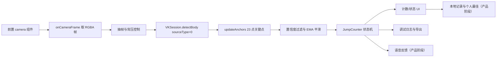
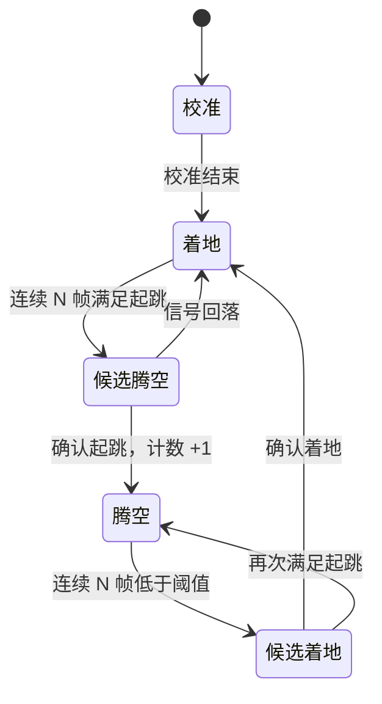

# 技术方案设计

## 元信息

| 属性 | 值 |
|------|-----|
| 项目编码 | PRJ-001 |
| 项目名称 | 微信跳绳计数器 |
| 文档版本 | v1.0 |
| 创建日期 | 2026-10-30 |
| 最后更新 | 2026-10-30 |
| 上游文档 | 需求清单 v1.1、成功标准 v1.2、业务流程 v1.2、技术规格 v1.1 |
| 关联原型 | `prototype/`（端侧识别验证原型） |

---

## 1. 目标与范围

### 1.1 目标

在不引入云端识别、不上传摄像头画面的前提下，验证并落地微信小程序端侧跳绳识别方案，满足：

- 前置摄像头、实时镜像预览。
- 单人真实跳绳，按起跳次数计数（双摇算 1 次）。
- 支持并跳、交替跳、交叉跳、双摇。
- 正常光照、单人、手机固定、1 分钟条件下，100 次误差 ≤ ±5 次。
- 目标机型实时识别、连续使用不因发热/耗电不可用。

### 1.2 本文档范围

- 平台能力选型与端侧识别路径。
- 端侧识别、关键点提取、计数状态机设计。
- 前端、存储、语音、隐私的技术方案。
- 风险、降级与开发阶段划分。

### 1.3 不在本文档范围

- 完整产品 UI 的视觉设计。
- 训练数据集采集与模型训练细节（验证阶段产出）。
- 小程序审核材料的具体文案。

---

## 2. 平台能力与选型

微信小程序可用的端侧视觉能力主要有三条路径：

| 路径 | 能力 | 约束 | 适用性 |
|------|------|------|--------|
| A. VisionKit Body 实时模式 | `wx.createVKSession({track:{body:{mode:1}}})`，摄像头实时输出 23 个 2D 关键点；官方 demo 通过 `session.config.cameraPosition` 切换前后摄 | 基础库 ≥ 2.28.0；3D 关键点需微信 ≥ 8.1.0；需 WebGL/纹理渲染相机画面 | 可直接用原生相机与关键点，但渲染链路较重 |
| B. VisionKit Body 静态模式 + 自抽帧 | `camera` 组件（前置）+ `CameraContext.onCameraFrame` 取 RGBA 帧，逐帧调用 `VKSession.detectBody({sourceType:0})` | 基础库 ≥ 2.28.0；需自行控制抽帧与背压；每帧一次推理 | **本方案主路径**：前摄可控、叠加层简单、便于记录关键点日志 |
| C. 自训练 ONNX 模型 + `wx.createInferenceSession` | 基础库 ≥ 2.30.0，支持 ONNX、CPU/GPU/NPU | Beta；开发者工具不支持，必须真机调试；需自备模型与预处理 | 备选：VisionKit 精度不足时替换识别层 |

**决策：**

1. 验证原型采用 **路径 B**：`camera` 前置 + `onCameraFrame` + `detectBody`，因为需求明确前置摄像头，且该路径便于控制抽帧、背压、关键点日志与叠加层坐标。
2. 路径 A 作为对照实验：用 `session.config.cameraPosition = 1` 验证原生实时模式的前摄支持与帧率；若其精度/帧率更好，可在产品实现中替换捕获层，计数层不变。
3. 路径 C 作为精度不达标时的降级方案：优先尝试 MoveNet/BlazePose 等轻量姿态模型导出 ONNX，通过 `createInferenceSession` 端侧推理；不改变计数状态机接口。

**官方依据：**
- [VisionKit Body 检测](https://developers.weixin.qq.com/miniprogram/dev/framework/open-ability/visionkit/body.html)
- [VKSession.detectBody](https://developers.weixin.qq.com/miniprogram/dev/api/ai/visionkit/VKSession/VKSession.detectBody.html)
- [wx.createInferenceSession](https://developers.weixin.qq.com/miniprogram/dev/api/ai/inference/wx.createInferenceSession.html)
- 官方 demo：`wechat-miniprogram/miniprogram-demo` 的 `packageAPI/pages/ar/body-detect`、`body-detect-3d`

---

## 3. 总体架构



**分层：**

| 层 | 职责 | 原型对应 |
|----|------|---------|
| 展示层 | 取景、计数、结果、历史 | `pages/index`（仅验证页） |
| 采集层 | 摄像头权限、前摄预览、抽帧 | `camera` + `onCameraFrame` |
| 感知层 | VisionKit 人体关键点检测 | `VKSession.detectBody` |
| 计数层 | 起跳判定、状态机、去抖 | `utils/counting.js` |
| 反馈层 | 计数展示、语音播报 | 原型仅计数展示 |
| 存储层 | 本地记录、分档个人最佳 | 产品阶段实现 |
| 诊断层 | 关键点叠加、日志导出 | 原型 debug canvas + 剪贴板 |

---

## 4. 23 点关键点映射

官方 2D 人体为 23 点，索引来自官方文档标注图：

| 索引 | 部位 | 用途 |
|------|------|------|
| 0 | 颈/胸中心 | 躯干参考 |
| 1、2 | 头部上侧 | 仅调试 |
| 3、4 | 头部下侧 | 仅调试 |
| 5、6 | 左右肩 | 躯干高度、置信度 |
| 7、8 | 左右肘 | 调试 |
| 9、10 | 左右腕 | 无绳筛选（实验） |
| 11、12 | 左右髋 | 起跳主信号 |
| 13、14 | 左右膝 | 调试/辅助 |
| 15、16 | 左右踝 | 起跳辅助信号 |
| 17、18 | 左右手 | 调试 |
| 19-22 | 脚部/脚跟脚尖 | 调试 |

> 说明：左右解剖学命名需在真机上用「显示索引」模式确认；计数只依赖对称对（11/12、15/16），不依赖左右标签。

---

## 5. 计数算法设计

### 5.1 输入

- `anchor.points[23]`：归一化 2D 坐标 `(x, y)`。
- `anchor.confidence[23]`：关键点置信度。
- `anchor.size`：检测框宽高，作为躯干高度回退。
- `anchor.score`：人体检测置信度。
- 时间戳：用于校准、去抖与日志。

### 5.2 预处理

1. **置信度过滤**：低于 `minConfidence=0.3` 的关键点不参与计算。
2. **EMA 平滑**：`smoothed = prev*(1-α) + current*α`，默认 `α=0.5`，抑制关键点抖动。
3. **尺度归一化**：`bodyHeight = |hipY - shoulderY| * 2`；肩部不可用时回退 `anchor.size.height`。所有位移信号除以 `bodyHeight`，降低拍摄距离影响。

### 5.3 校准

开始计数前要求用户静止约 1 秒：

- 校准期内用 EMA 估计髋/踝基线，不计数。
- 校准结束后进入计数状态。
- 校准可避免「第一帧就在空中」导致基线错误。

### 5.4 起跳判定

- `hipSignal = (baselineHipY - hipY) / bodyHeight`
- `ankleSignal = (baselineAnkleY - ankleY) / bodyHeight`
- 默认起跳条件：
  - `hipSignal > heightRatio`（默认 0.06）
  - 且 `ankleSignal > heightRatio * 0.4`
  - 踝关键点缺失时，使用 `hipSignal > heightRatio * 1.2` 回退
- 可选手腕筛选：近 600ms 内腕部纵向活动范围 `wristRange` 需大于 `wristRatio`（默认 0.02）；默认关闭，待验证。

### 5.5 状态机



- `requiredFrames=2`：连续 2 帧满足才切换，抑制单帧噪声。
- `refractoryMs=220`：两次计数最小间隔，避免同一跳重复计数。
- 计数发生在「着地 → 腾空」的起跳瞬间，符合「起跳次数」口径。
- 双摇：一次起跳只产生一次状态迁移，因此自然计 1 次。
- 着地阶段以 `baselineBeta=0.02` 缓慢更新基线，适应站位漂移。

### 5.6 无绳空跳处理

这是当前方案最大的不确定性：

- VisionKit 只输出人体关键点，不输出绳子位置，无法直接判断「有没有绳」。
- 原型实现了一个可选的腕部活动筛选：
  - 手臂静止的无绳空跳会被拒绝（已验证合成数据）。
  - 甩腕的无绳空跳仍会被计数（合成数据已复现）。
- 产品化需要二选一或组合：
  1. 采集真绳/无绳甩腕的关键点序列，训练一个轻量时序分类器（输入腕/踝/髋轨迹），作为计数门控。
  2. 增加轻量绳子检测模型（目标检测/线段检测），与姿态识别并行；成本更高。
- 在验证完成前，不得对外承诺「无绳空跳完全不计」。

### 5.7 伪代码

```text
onAnchor(anchor, now):
  if not enough confidence: return
  smooth hip/ankle; compute bodyHeight
  if now - startedAt < calibrationMs:
    update baselines; return count
  hipSignal, ankleSignal = normalized displacements
  isJump = hipSignal > threshold && ankleSignal > threshold*0.4
  if ankles missing: isJump = hipSignal > threshold*1.2
  if requireWrist && wristRange < wristThreshold: isJump = false
  if grounded && isJump for N frames:
    airborne = true; count++
  if airborne && !isJump for N frames:
    airborne = false; update baseline slowly
```

实现见 `prototype/miniprogram/utils/counting.js`；合成序列单元测试见 `prototype/tests/counting.test.js`。

---

## 6. 前置摄像头与镜像

- 采用 `<camera device-position="front">`，确保满足 FR-002/FR-003。
- 前置预览通常按镜像显示；关键点坐标来自未镜像的帧数据，因此叠加层需要镜像开关：
  - `mirrorKeypoints=true` 时绘制 `x = 1 - x`。
  - 真机验证时用「举右手」确认预览与关键点方向一致。
- 路径 A 对照：`session.config.cameraPosition = 1`（官方 demo 的切换前后摄方式），需验证其在目标机型上是否生效。

---

## 7. 性能策略

| 策略 | 说明 |
|------|------|
| 抽帧限频 | 默认 15fps 调用 `detectBody`，相机预览保持原生帧率 |
| 单飞背压 | 同一时间只允许一个 `detectBody` 在途；`updateAnchors` 或 400ms 超时后释放 |
| UI 降频 | `setData` 限制约 5fps，计数变化时立即更新 |
| 分辨率 | `frame-size="medium"`；后续可尝试 small 以降低 CPU |
| 区域裁剪 | 产品阶段可按检测框裁剪 ROI 再送入识别，降低计算量 |
| 降级 | 低端机降低处理帧率至 10fps；仍不满足则走 ONNX 轻量模型 |

---

## 8. 语音与本地存储（产品阶段）

### 8.1 语音

- 优先使用本地预录音频，避免 TTS 网络依赖与隐私风险。
- 数字音频：10、20、…、600 共 60 个文件；倒计时 3、2、1 三个文件。
- 播报规则：每 10 次播放对应数字；最后 3 秒按整秒边界播放；不播报剩余时间；无静音开关。
- 若使用 TTS，需评估网络、隐私与审核要求。

### 8.2 本地存储

```js
records: [{ id, date, count, duration }]
bests: { 30: number, 60: number, 180: number }
```

- 每次完成后写入一条记录，并更新对应档位最佳。
- 写入失败时提示，且不更新最佳，避免「有最佳、无历史」。
- 存储容量与清理策略待验证；原型阶段不实现。

---

## 9. 风险与降级

| 风险 | 影响 | 应对 |
|------|------|------|
| VisionKit 对交叉跳/双摇关键点抖动大 | 计数误差超标 | 调整平滑/阈值；采集数据训练分类器；必要时换 ONNX 模型 |
| 无绳甩腕无法区分 | 误计 | 时序分类器或绳子检测；验证前不承诺 |
| 前摄镜像/坐标映射错误 | 叠加错位，影响调试 | 镜像开关 + 举右手校准；路径 A 对照 |
| 低端机帧率/发热不足 | 识别中断 | 降帧率、ROI、ONNX 轻量模型；锁定机型基线 |
| VisionKit 版本/机型兼容 | 部分用户不可用 | 基础库检测 + 降级提示；最低版本待实测 |
| 开发者工具不支持真机能力 | 无法在模拟器验证 | 必须真机调试；准备 Android/iOS 各一台 |
| 本地存储容量上限 | 历史记录丢失 | 容量测试；后续定义清理策略 |

---

## 10. 开发阶段

| 阶段 | 内容 | 产出 |
|------|------|------|
| M0 验证（当前） | VisionKit 接入、关键点叠加、计数状态机、日志导出 | `prototype/` + 验证报告 |
| M1 调优 | 四种跳法、无绳筛选、光照/距离/角度测试 | 阈值与算法结论 |
| M2 MVP | 首页/取景/计数/结果/历史页面、语音、本地存储 | 可体验小程序 |
| M3 上线 | 性能优化、隐私协议、类目审核、真机回归 | 公开发布 |

---

## 11. 待确认问题

1. 23 点中左右侧的解剖学对应关系（用「显示索引」真机确认）。
2. 前摄预览与帧数据的镜像关系。
3. 无绳空跳的产品化判定方案（分类器 vs 绳子检测）。
4. 目标机型与最低微信版本基线。
5. 语音采用预录音频还是 TTS。
6. 本地历史容量与清理策略。

---

## 参考

- [VisionKit Body 检测](https://developers.weixin.qq.com/miniprogram/dev/framework/open-ability/visionkit/body.html)
- [VKSession.detectBody](https://developers.weixin.qq.com/miniprogram/dev/api/ai/visionkit/VKSession/VKSession.detectBody.html)
- [wx.createVKSession](https://developers.weixin.qq.com/miniprogram/dev/api/ai/visionkit/wx.createVKSession.html)
- [wx.createInferenceSession](https://developers.weixin.qq.com/miniprogram/dev/api/ai/inference/wx.createInferenceSession.html)
- [CameraContext.onCameraFrame](https://developers.weixin.qq.com/miniprogram/dev/api/media/camera/CameraContext.onCameraFrame.html)
- [官方小程序 demo](https://github.com/wechat-miniprogram/miniprogram-demo)
